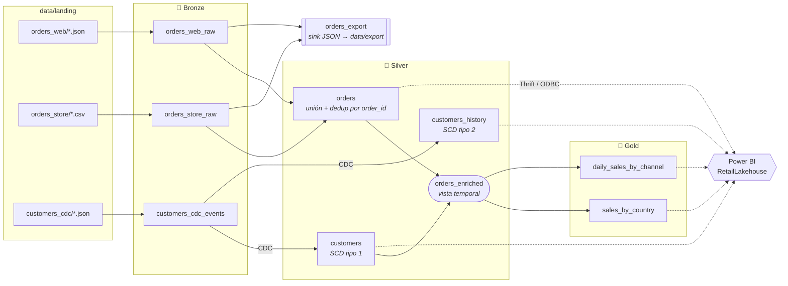
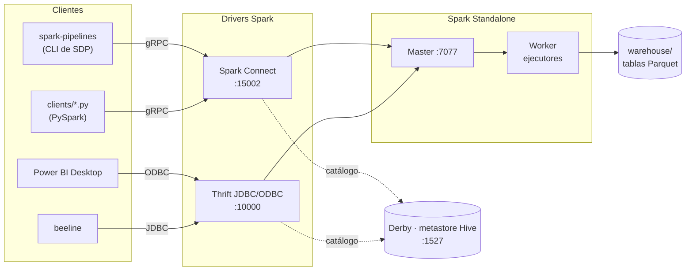
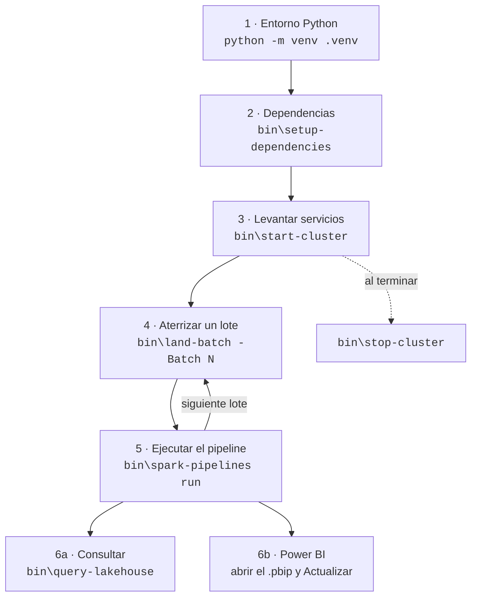

# Retail Lakehouse · Spark Declarative Pipelines

Lakehouse de ejemplo con arquitectura medallón (bronze → silver → gold) construido con
**Spark Declarative Pipelines (SDP)** sobre **Apache Spark 4.3**, con ingesta incremental,
Change Data Capture (SCD tipo 1 y 2) y un reporte de **Power BI** conectado por el Thrift JDBC/ODBC Server.

## Flujo de datos



- **Landing** recibe archivos por lote (JSON y CSV), simulando lo que llega de los sistemas de origen.
- **Bronze** (streaming tables) lee de forma incremental solo los archivos nuevos de cada carpeta (checkpoints en `storage/`).
- **Silver** une los canales sin duplicados y aplica los eventos de cambio de clientes: versión vigente (SCD1)
  e historial completo con `__START_AT` / `__END_AT` (SCD2).
- **Gold** (materialized views) agrega sobre `orders_enriched` (pedidos + país actual del cliente), una vista que solo existe durante la ejecución.
- **Exports** publica los pedidos nuevos fuera del pipeline, en un único flow para los dos canales.
- **Power BI** importa silver y gold por el Thrift JDBC/ODBC Server.

## Arquitectura en ejecución



Spark Connect recibe planes de DataFrame (código); el Thrift Server recibe SQL (herramientas de BI). Los dos
comparten el cluster y el catálogo: Derby corre en modo red porque en modo embebido admite una sola JVM.
Detalle en [`docs/architecture.md`](docs/architecture.md).

## Stack

| Componente | Uso |
|---|---|
| Apache Spark 4.3 (Standalone: master + worker) | Motor de cómputo |
| Spark Declarative Pipelines | Definición declarativa de datasets y flujos |
| Spark Connect (`sc://127.0.0.1:15002`) | Ejecución del pipeline y clientes PySpark |
| Thrift JDBC/ODBC Server (`127.0.0.1:10000`) | Acceso SQL para herramientas de BI |
| Hive metastore sobre Apache Derby en modo red (`:1527`) | Catálogo compartido por Connect y Thrift |
| Parquet | Formato de las tablas (`warehouse/`) |
| Power BI (PBIP + TMDL, conector Spark) | Reporte `RetailLakehouse` |

## Estructura

```
├── pipelines/retail_lakehouse/      Pipeline SDP
│   ├── spark-pipeline.yml           Spec (plantilla: ${PROJECT_ROOT_URI} se resuelve al correr)
│   └── transformations/
│       ├── bronze/                  Ingesta incremental desde data/landing
│       ├── silver/                  Pedidos unificados, clientes SCD1 y SCD2
│       ├── gold/                    Ventas por país y por día/canal
│       └── exports/                 Sink de pedidos nuevos (JSON)
├── src/retail_lakehouse/            Librería compartida (esquemas, lógica CDC)
├── clients/                         Clientes Spark Connect (bootstrap del catálogo, consultas)
├── bin/                             Scripts de operación (Windows: .cmd → .ps1)
├── conf/                            spark-defaults, log4j2, entorno (spark-env.ps1)
├── bi/powerbi/                      Proyecto Power BI (PBIP) + generador del modelo
├── data/samples/                    Lotes de datos de ejemplo
├── docs/                            Arquitectura y operación
└── jars/                            Jars extra opcionales (no versionados)
```

Las carpetas `warehouse/`, `metastore_db/`, `storage/`, `logs/`, `work/`, `data/landing/` y `data/export/`
son estado de ejecución: se generan al correr y no se versionan.

## Requisitos

- Windows 10/11 con PowerShell 5.1
- Java 17 (`JAVA_HOME`)
- Apache Spark 4.3.0 (`SPARK_HOME` como variable de usuario) y `HADOOP_HOME` con `winutils.exe`
- Python 3.13
- Power BI Desktop **2.159 (noviembre 2026) o posterior**, con la versión preliminar
  *Store reports using enhanced metadata format (PBIR)* activada

## Puesta en marcha



```powershell
# 1. Entorno Python (PySpark se usa desde SPARK_HOME\python, no se instala con pip)
python -m venv .venv
.venv\Scripts\python -m pip install -r requirements.txt

# 2. Jars que no vienen con Spark (Derby en modo red), con verificación SHA-1
bin\setup-dependencies.cmd

# 3. Levantar Derby, el cluster, Spark Connect y el Thrift Server
bin\start-cluster.cmd

# 4. Aterrizar datos de ejemplo y correr el pipeline
bin\land-batch.cmd -Batch 1
bin\spark-pipelines.cmd run

# 5. Consultar las tablas
bin\query-lakehouse.cmd
```

Los lotes 2 y 3 ejercitan updates, deletes, duplicados y eventos fuera de orden (ver `data/samples/README.md`).

### Power BI

Abrir `bi/powerbi/RetailLakehouse.pbip` y **Actualizar**. Credenciales: *Nombre de usuario y contraseña*
con cualquier valor (el Thrift Server local no tiene autenticación; solo escucha en `127.0.0.1`).
Ver `docs/operations.md`.

## Datasets

| Capa | Dataset | Tipo | Descripción |
|---|---|---|---|
| bronze | `orders_web_raw`, `orders_store_raw` | streaming table | Pedidos crudos por canal (JSON / CSV) |
| bronze | `customers_cdc_events` | streaming table | Eventos de cambio de clientes |
| silver | `orders` | materialized view | Pedidos de todos los canales, sin duplicados |
| silver | `customers` | materialized view | Versión vigente de cada cliente (SCD1) |
| silver | `customers_history` | materialized view | Todas las versiones (SCD2, `__START_AT`/`__END_AT`) |
| silver | `orders_enriched` | vista temporal | Pedidos + cliente; solo durante la ejecución |
| gold | `sales_by_country`, `daily_sales_by_channel` | materialized view | Agregados para consumo |
| exports | `orders_export` | sink | Pedidos nuevos en JSON |

## Limitaciones

- **Parquet en lugar de un formato transaccional.** Dos flows no pueden escribir al mismo target: comparten el
  registro `_spark_metadata` y el segundo se saltea en silencio. Por eso cada canal tiene su streaming table y la
  unión se hace en `silver.orders`.
- **AUTO CDC** (`create_auto_cdc_flow`) necesita un catálogo con operaciones a nivel fila (Apache Iceberg) y todavía
  no hay runtime de Iceberg para Spark 4.3. `src/retail_lakehouse/cdc.py` reproduce su semántica con los mismos
  parámetros, para migrar sin cambiar el modelo.
- **`--full-refresh-all`** falla con Parquet (los materialized views leen archivos ya borrados). Usar
  `bin\reset-pipeline.cmd`, que borra el estado y reinicia el cluster.
- **Derby** es un metastore de desarrollo. En producción: PostgreSQL/MySQL, Unity Catalog o AWS Glue
  (ver `docs/architecture.md`).

## Licencia

[MIT](LICENSE)
