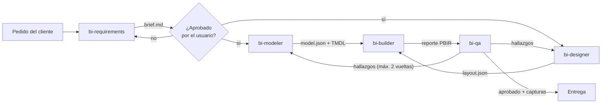

# Especificaciones de reportes


Cada reporte de Power BI se construye con un **equipo de agentes** (`.claude/agents/`) coordinado por el comando
`/build-report`. Los agentes no se hablan directamente: se pasan **documentos** que quedan versionados en
`bi/specs/<slug>/`, igual que un equipo de BI se pasa un brief, un modelo y un wireframe.

```
/build-report "Quiero analizar cómo cambian los datos de los clientes"
```



## Contratos entre agentes

| Agente | Lee | Escribe (solo esto) | Herramienta |
|---|---|---|---|
| `bi-requirements` | El pedido, `docs/architecture.md`, las tablas | `brief.md` | — |
| `bi-modeler` | `brief.md` | `model.json`, `bi/powerbi/<Reporte>.SemanticModel/` | `bi/powerbi/tools/generate_model.py` |
| `bi-designer` | `brief.md` | `layout.json` | — |
| `bi-builder` | `layout.json`, el modelo | `bi/powerbi/<Reporte>.Report/`, `<Reporte>.pbip` | `bi/powerbi/tools/build_report.py` |
| `bi-qa` | Todo | `qa-report.md`, `screenshots/` | `pbir validate`, `tmdl-validate`, `pbir desktop screenshot` |

El brief fija los **nombres de las medidas**: así modelado y diseño pueden trabajar en paralelo.

## Estructura

```
bi/specs/
├── README.md                 este archivo
├── _template/brief.md        plantilla del brief
├── retail-lakehouse/         ejemplo completo (el reporte RetailLakehouse)
│   ├── model.json
│   └── layout.json
└── <slug>/                   un reporte construido por el equipo
    ├── brief.md
    ├── model.json
    ├── layout.json
    ├── qa-report.md
    └── screenshots/*.png
```

## `model.json`

```json
{
  "name": "CambiosClientes",
  "spark_server": "127.0.0.1:10000",
  "database": "retail",
  "culture": "es-AR",
  "tables": {
    "customers_history": {
      "description": "Historial SCD2 de clientes.",
      "columns": [
        { "name": "customer_id", "type": "int64", "summarize": "none", "format": "0" },
        { "name": "country", "type": "string", "summarize": "none" }
      ],
      "calculated": [
        { "name": "Estado", "expression": "IF ( ISBLANK ( customers_history[__END_AT] ), \"Vigente\", \"Histórica\" )",
          "description": "Vigente si la versión no fue reemplazada." }
      ],
      "measures": [
        { "name": "Versiones", "expression": "COUNTROWS ( customers_history )", "format": "#,0",
          "description": "Cantidad de versiones." }
      ]
    }
  },
  "relationships": [ { "from": "customers_history.customer_id", "to": "customers.customer_id" } ]
}
```

- Cada clave de `tables` es una tabla de `retail` en Spark (o usar `"source"` para otro nombre).
- `type`: `string`, `int64`, `double`, `decimal`, `boolean`, `dateTime`, `date`.
- `summarize`: `none`, `sum`, `min`, `max`, `count`, `average`, `distinctCount`.
- El generador valida tipos, relaciones y nombres antes de escribir.

## `layout.json`

```json
{
  "report": "CambiosClientes",
  "model": "CambiosClientes",
  "pages": [
    {
      "name": "Resumen",
      "visuals": [
        { "visual_type": "card", "name": "card_versiones", "x": 20, "y": 100, "width": 300, "height": 140,
          "title": "Versiones", "fields": { "Values": "customers_history.Versiones" } },
        { "visual_type": "lineChart", "name": "line_dia", "x": 20, "y": 260, "width": 620, "height": 250,
          "title": "Ventas por día", "fields": { "Category": "daily_sales_by_channel.order_date",
                                                  "Y": "daily_sales_by_channel.Ventas diarias" },
          "properties": { "categoryAxis.axisType": "Categorical" } }
      ]
    }
  ]
}
```

- Página de 1280 × 720. El título lo crea el constructor en la franja y=0..90: los visuales van en **y ≥ 100** y
  terminan en **y + alto ≤ 710**, con márgenes y separaciones de 20 px.
- Mínimos: tarjetas 140 de alto, gráficos 250, tablas 200.
- `fields` usa `tabla.campo`; `Y` y las tarjetas solo aceptan **medidas**.
- `properties` aplica propiedades de formato con `pbir set` (ruta `contenedor.propiedad`).
- `filters` agrega filtros de nivel visual con `pbir add filter`, **solo sobre columnas** (no medidas):
  `"filters": [{ "field": "customers.Cambió de país", "type": "Categorical", "values": ["Sí"] }]`.
  Para filtrar por una condición sobre una medida, el modelador la expresa como columna calculada.
- `sort` ordena una tabla o un gráfico por un campo del visual: `"sort": { "field": "tabla.campo", "direction": "Ascending" }`.
- Segmentador: `"visual_type": "slicer"` con `"fields": { "Values": "tabla.columna" }`; selección simple con
  `"properties": { "selection.singleSelect": true }`.
