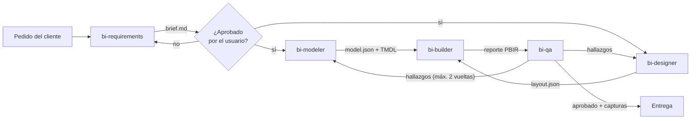

# Especificaciones de reportes


El proyecto tiene **un solo reporte de Power BI**, `bi/powerbi/RetailLakehouse.pbip` (con su modelo
`RetailLakehouse.SemanticModel`), que evoluciona con cada pedido del cliente. Lo mantiene un **equipo de agentes**
(`.claude/agents/`) coordinado por el comando `/build-report`: cada pedido agrega o modifica páginas, sube la
versión y deja una entrada en `retail-lakehouse/CHANGELOG.md`. Los agentes no se hablan directamente: se pasan
**documentos** versionados en `bi/specs/retail-lakehouse/`, igual que un equipo de BI se pasa un brief, un modelo
y un wireframe. Todas las páginas siguen el sistema de diseño **LakehouseModern** (skill `bi-design-system`,
tema en `bi/design/LakehouseModern.Theme/`).

```
/build-report "Agregá una página con el ranking de clientes por ticket promedio"
```



## Contratos entre agentes

| Agente | Lee | Escribe (solo esto) | Herramienta |
|---|---|---|---|
| `bi-requirements` | El pedido, el brief y el CHANGELOG actuales, `docs/`, las tablas | `brief.md` | — |
| `bi-modeler` | `brief.md`, `model.json` y `layout.json` actuales | `model.json`, `bi/powerbi/RetailLakehouse.SemanticModel/` | `bi/powerbi/tools/generate_model.py` |
| `bi-designer` | `brief.md`, `layout.json` actual, skill `bi-design-system` | `layout.json`, entrada de `CHANGELOG.md` | — |
| `bi-builder` | `layout.json`, el modelo, el tema | `bi/powerbi/RetailLakehouse.Report/`, `RetailLakehouse.pbip` | `bi/powerbi/tools/build_report.py` |
| `bi-qa` | Todo | `qa-report.md`, `screenshots/` | `pbir validate`, `tmdl-validate`, `pbir desktop screenshot` |

El brief fija los **nombres de las medidas**: así modelado y diseño pueden trabajar en paralelo. Los criterios de
aceptación de versiones anteriores se conservan: QA los vuelve a verificar en cada versión (regresión).

## Versiones

| Cambio | Versión |
|---|---|
| Se quita o se rehace una página, o el modelo cambia de forma incompatible | mayor (`3.0`) |
| Se agrega una página, un visual, una medida, una columna o un filtro | menor (`2.1`) |
| Correcciones de QA, formato o textos | parche (`2.0.1`) |

La versión está en `layout.json`, en la banda de encabezado de cada página y en la anotación `version` del
reporte. `build_report.py` no construye una versión sin su entrada `## [x.y]` en `CHANGELOG.md`.

## Estructura

```
bi/
├── design/LakehouseModern.Theme/   tema del sistema de diseño (fragmentos de pbir theme build)
├── powerbi/
│   ├── RetailLakehouse.pbip         el único reporte (se reconstruye desde layout.json)
│   ├── RetailLakehouse.Report/
│   ├── RetailLakehouse.SemanticModel/
│   └── tools/                       generate_model.py, build_report.py
└── specs/
    ├── README.md                    este archivo
    ├── _template/brief.md           plantilla del brief
    └── retail-lakehouse/
        ├── brief.md                 preguntas, KPIs y criterios (acumulados por versión)
        ├── model.json               modelo semántico
        ├── layout.json              páginas y visuales (fuente de verdad del reporte)
        ├── CHANGELOG.md             historial de versiones
        ├── qa-report.md
        └── screenshots/*.png
```

`layout.json` es la fuente de verdad: el reporte se reconstruye entero en cada versión, así que un cambio hecho a
mano en Power BI Desktop se pierde si no se pasa a `layout.json`.

## `model.json`

```json
{
  "name": "RetailLakehouse",
  "spark_server": "127.0.0.1:10000",
  "database": "retail",
  "culture": "es-AR",
  "tables": {
    "customers_history": {
      "description": "Historial SCD2 de clientes.",
      "columns": [
        { "name": "customer_id", "type": "int64", "summarize": "none", "format": "0" },
        { "name": "country", "type": "string", "summarize": "none" }
      ],
      "calculated": [
        { "name": "Estado", "expression": "IF ( ISBLANK ( customers_history[__END_AT] ), \"Vigente\", \"Histórica\" )",
          "description": "Vigente si la versión no fue reemplazada." }
      ],
      "measures": [
        { "name": "Versiones", "expression": "COUNTROWS ( customers_history )", "format": "#,0",
          "description": "Cantidad de versiones." }
      ]
    }
  },
  "relationships": [ { "from": "customers_history.customer_id", "to": "customers.customer_id" } ]
}
```

- Cada clave de `tables` es una tabla de `retail` en Spark (o usar `"source"` para otro nombre).
- `type`: `string`, `int64`, `double`, `decimal`, `boolean`, `dateTime`, `date`.
- `summarize`: `none`, `sum`, `min`, `max`, `count`, `average`, `distinctCount`.
- El generador valida tipos, relaciones y nombres antes de escribir.

## `layout.json`

```json
{
  "report": "RetailLakehouse",
  "model": "RetailLakehouse",
  "label": "Retail Lakehouse",
  "version": "2.1",
  "theme": "bi/design/LakehouseModern.Theme",
  "pages": [
    {
      "name": "Resumen",
      "subtitle": "Versiones de clientes y ventas diarias",
      "visuals": [
        { "visual_type": "card", "name": "card_versiones", "x": 20, "y": 100, "width": 300, "height": 140,
          "title": "Versiones", "fields": { "Values": "customers_history.Versiones" } },
        { "visual_type": "lineChart", "name": "line_dia", "x": 20, "y": 260, "width": 620, "height": 250,
          "title": "Ventas por día", "fields": { "Category": "daily_sales_by_channel.order_date",
                                                  "Y": "daily_sales_by_channel.Ventas diarias" },
          "properties": { "categoryAxis.axisType": "Categorical" } }
      ]
    }
  ]
}
```

- `label` (nombre visible del reporte), `version` y `subtitle` (por página) se muestran en la banda de encabezado.
  `theme` es opcional (por defecto `bi/design/LakehouseModern.Theme`).
- Página de 1280 × 720. La banda de encabezado la crea el constructor en y=0..80: los visuales van en **y ≥ 100** y
  terminan en **y + alto ≤ 710**, con márgenes y separaciones de 20 px. Grilla, arquetipos y tamaños mínimos:
  skill `bi-design-system` (tarjetas 120 de alto, barras `60 + 30 × categorías`, tablas sin desplazamiento).
- Formato y colores vienen del tema: `properties` solo para lo que exige el contenido, nunca colores literales.
- `fields` usa `tabla.campo`; `Y` y las tarjetas solo aceptan **medidas**.
- `properties` aplica propiedades de formato con `pbir set` (ruta `contenedor.propiedad`).
- `filters` agrega filtros de nivel visual con `pbir add filter`, **solo sobre columnas** (no medidas):
  `"filters": [{ "field": "customers.Cambió de país", "type": "Categorical", "values": ["Sí"] }]`.
  Para filtrar por una condición sobre una medida, el modelador la expresa como columna calculada.
- `field_names` (al nivel del layout) da nombres de negocio a columnas técnicas en todo el reporte:
  `"field_names": { "dim_customer.name": "Cliente", "fact_customer_changes.changed_at": "Fecha del cambio" }`.
- Propiedades útiles: tarjeta `labels.labelDisplayUnits` (1 = sin unidades), `labels.labelPrecision` (decimales),
  `categoryLabels.show` (`false` si el título ya nombra la medida); tabla `total.totals` (`false` sin fila Total);
  segmentador `header.text`; gráfico `labels.show`, `valueAxis.start` (0).
- Para ocultar el miembro desconocido en segmentadores y ejes: filtro sobre la clave oculta,
  `{ "field": "dim_channel.channel_key", "type": "Advanced", "operator": "GreaterThan", "values": [0] }`.
- `sort` ordena una tabla o un gráfico por un campo del visual: `"sort": { "field": "tabla.campo", "direction": "Ascending" }`.
- Segmentador: `"visual_type": "slicer"` con `"fields": { "Values": "tabla.columna" }`; selección simple con
  `"properties": { "selection.singleSelect": true }`.
