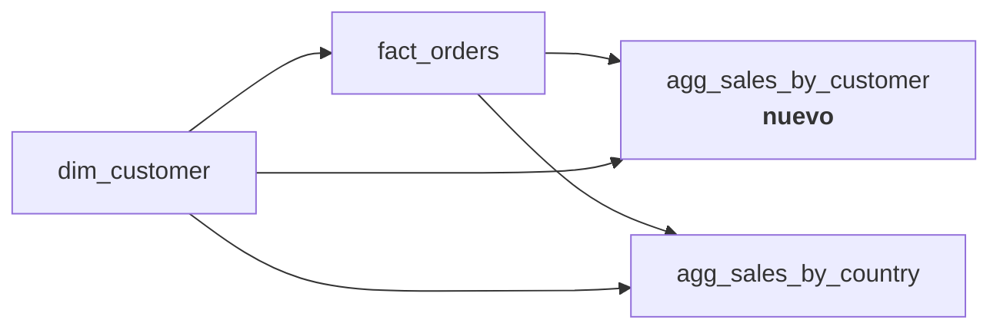

# Design: CHG-2026-001 · Resumen de compras por cliente (piloto)

- **Autor:** data-architect
- **Request:** `request.md` (aprobado 2026-11-22)

## Resumen

Se agrega un agregado gold nuevo, `retail.agg_sales_by_customer`: una fila por cliente (clave de negocio
`customer_id`) con cantidad de pedidos, importe total, ticket promedio, primera y última fecha de compra, y nombre y
país de la versión actual del cliente. Se calcula **desde `fact_orders`** (regla de la sección 6 de
`docs/data-model.md`) con el mismo patrón que `agg_sales_by_country`: cada pedido llega a `customer_id` por su
`customer_sk` (la versión vigente al comprar) y los atributos actuales se toman de la última versión del cliente en
`dim_customer`. Es un materialized view SQL; no se toca bronze, silver, las tablas existentes ni el reporte.

## Modelo

| Tabla | Capa | Tipo SDP | Grano | Claves | Historia | Nueva / cambia |
|---|---|---|---|---|---|---|
| `retail.agg_sales_by_customer` | gold | materialized view | un cliente (`customer_id`) con al menos un pedido | `customer_id` (clave de negocio; sin clave sustituta, como los demás agregados) | sin historia: estado actual (recalculo completo en cada corrida) | nueva |

### Columnas

Tipos verificados con `DESCRIBE retail.fact_orders` / `retail.dim_customer` (Thrift, 2026-11-22):
`amount decimal(12,2)`, `order_ts timestamp`, `customer_sk bigint`, `customer_id int`, `version bigint`,
`name string`, `country string`, `is_current boolean`.

| Tabla | Columna | Tipo | Nulo | Regla / origen |
|---|---|---|---|---|
| `agg_sales_by_customer` | `customer_id` | int | no | `dim_customer.customer_id` de la versión unida al pedido (`fact_orders.customer_sk = dim_customer.customer_sk`). Único. Responde P6 |
| | `name` | string | no | `name` de la **última versión** del cliente en `dim_customer` (`max_by(name, version)`). Responde P6 |
| | `country` | string | no | `country` de la versión vigente (`is_current`); si el cliente no tiene versión vigente (dado de baja sin reinsertar): `'N/A'`, igual que `agg_sales_by_country`. Responde P5 |
| | `orders` | bigint | no | `count(*)` de `fact_orders` (un pedido por fila: `order_id` es único en el hecho). P1 |
| | `total_amount` | decimal(22,2) | no | `sum(f.amount)` (tipo resultante de Spark para `sum` de `decimal(12,2)`). P2 |
| | `average_order` | decimal(13,2) | no | `round(avg(f.amount), 2)` (tipo verificado; igual a `agg_sales_by_country.average_order`): total / pedidos, redondeo HALF_UP (87.495 → 87.50; 132.625 → 132.63). Mismo nombre y fórmula que en `agg_sales_by_country`. P3 |
| | `first_order_date` | date | no | `min(to_date(f.order_ts))`. P4 |
| | `last_order_date` | date | no | `max(to_date(f.order_ts))`. P4 |
| | `_loaded_at` | timestamp | no | `current_timestamp()` (convención de auditoría de gold, sección 7 de `data-model.md`) |

Consulta de referencia (validada contra el catálogo actual; devuelve exactamente los valores de CA1 a CA6):

```sql
WITH customer_latest AS (           -- atributos actuales: una fila por customer_id
  SELECT customer_id,
         max_by(name, version)                       AS name,
         max_by(country, version)                    AS last_country,
         bool_or(is_current)                         AS has_current
  FROM dim_customer
  GROUP BY customer_id
)
SELECT
  c.customer_id,
  cl.name,
  CASE WHEN cl.has_current THEN cl.last_country ELSE 'N/A' END AS country,
  count(*)                       AS orders,
  sum(f.amount)                  AS total_amount,
  round(avg(f.amount), 2)        AS average_order,
  min(to_date(f.order_ts))       AS first_order_date,
  max(to_date(f.order_ts))       AS last_order_date,
  current_timestamp()            AS _loaded_at
FROM fact_orders f
JOIN dim_customer c      ON c.customer_sk  = f.customer_sk
JOIN customer_latest cl  ON cl.customer_id = c.customer_id
GROUP BY c.customer_id, cl.name, cl.has_current, cl.last_country
```

La versión vigente de un cliente, si existe, es siempre la de mayor `version` (el CDC ordena por versión y solo la
última puede seguir abierta; el control 05 garantiza a lo sumo una vigente), así que `max_by(country, version)` con
`has_current` equivale a unir con `is_current` y además da un nombre para los clientes dados de baja.

**Miembro desconocido.** Un pedido con `customer_sk = -1` se une a la fila desconocida de `dim_customer`
(`customer_id = -1`, `name`/`country` = `'Desconocido'`, `is_current = true`) y aparece en una fila
`customer_id = -1`. Así el agregado siempre reconcilia con `fact_orders`; el control 02 ya reporta ese caso como
falla. Con los lotes 1 a 3 no ocurre (CA1: 6 filas).

### Matriz de bus (si cambia gold)

No cambia: no se agregan hechos ni dimensiones. El agregado se deriva de `fact_orders` y usa `dim_customer`, como
`agg_sales_by_country`. En la sección 6 de `data-model.md` se agrega una fila a la tabla de agregados.

## Grafo del pipeline



- `agg_sales_by_customer`: **SQL** (lógica de conjuntos: join y agregación), en
  `pipelines/retail_lakehouse/transformations/gold/sql/aggregates/agg_sales_by_customer.sql`. El glob
  `transformations/**` lo descubre; no hay que tocar `spark-pipeline.yml`.
- Dependencias: al ser SQL (`FROM fact_orders`, `FROM dim_customer`) SDP registra la dependencia siempre; no hace
  falta una vista `src_*` (la regla aplica solo a datasets Python).
- Un único dataset y un único flow escriben el target: sin conflicto con el límite de Parquet.

## Impacto

| Afectado | Cómo | Acción |
|---|---|---|
| `retail.fact_orders`, `retail.dim_customer` | Solo lectura; se agrega un consumidor dentro del pipeline | ninguna |
| `retail.agg_sales_by_country` y demás tablas | Sin cambios | ninguna |
| Controles de calidad | 01 a 07 sin cambios (CA8). Se agregan 08 a 11 para la tabla nueva (11: regresión de `average_order` y fechas) | tareas T1–T3b (`data-quality-engineer`) |
| Reporte `RetailLakehouse` | No usa la tabla nueva; `model.json` no cambia | ninguna (fuera de alcance; sería otro pedido con G4) |
| Documentación | `data-model.md`: árbol de código (sección 1), agregados (sección 6), controles (sección 8). `architecture.md`: grafo y tabla de datasets (sección 4), tabla de gold (sección 7), cantidad de tablas del catálogo (13 → 14, sección 1) | al cierre, T6 (`data-architect`) |
| Datos personales | El agregado expone `name` (ya presente en `dim_customer`); no expone email | clasificación en `docs/governance.md`: *fase 3 · escalar* (T7) |
| Contratos | `contracts/` no existe todavía (fase 2) | no se escribe contrato; el esquema queda fijado por esta tabla de columnas |
| Costo | Un materialized view más, recalculado completo en cada corrida; volumen = clientes con pedidos (6 filas) | ninguna |

## Compatibilidad

Cambio compatible: tabla nueva, ninguna columna existente se renombra, borra ni cambia de grano. Ningún consumidor
deja de funcionar. Sin migración: la tabla aparece en la siguiente corrida del pipeline (no requiere full refresh
ni reset; con un reset desde cero también se crea).

## Decisiones

| Decisión | Alternativas | Motivo |
|---|---|---|
| Nombre `agg_sales_by_customer` | `agg_customer_purchases`, `customer_summary` | Convención `agg_*` y paralelismo con `agg_sales_by_country` (mismas métricas `orders`, `total_amount`, `average_order` con el mismo significado) |
| Agregado gold derivado de `fact_orders` | Calcular desde `silver.orders` + `silver.customers`; extender `dim_customer` con métricas | Regla de la sección 6 (una sola fuente de verdad de importes). Poner métricas en una dimensión SCD2 mezcla grano (versión vs. cliente) y rompe la separación hechos/dimensiones |
| Agrupar por `customer_id`, no por `customer_sk` | Por `customer_sk` (versión) | Requisito del pedido: un cliente con varias versiones no se parte (CA7) |
| País y nombre de la última versión (`max_by(..., version)` + `bool_or(is_current)`) | `LEFT JOIN dim_customer ON is_current` (patrón de `agg_sales_by_country`) | Mismo resultado para el país; además da un nombre no nulo para clientes dados de baja, sin un segundo join |
| Cliente sin versión vigente: `country = 'N/A'` | `NULL`; país de la última versión conocida | Consistente con `agg_sales_by_country` (mismo valor centinela); columna no nula. Un país "último conocido" se confundiría con el actual |
| Pedidos del miembro desconocido en fila `customer_id = -1` | Excluirlos (`INNER JOIN` filtrando `-1`) | El agregado reconcilia siempre con `fact_orders`; el control 02 ya señala el problema de origen |
| `average_order = round(avg(amount), 2)` | `round(sum/count, 2)` | `avg` de decimal es exacto y equivale a total/pedidos; redondeo HALF_UP cumple el supuesto del pedido; misma fórmula que `agg_sales_by_country` |
| Fechas como `date` (no `date_key`) | `first_order_date_key int` | Los agregados no se relacionan con dimensiones (como `agg_daily_sales_by_channel.order_date`); la fecha es directamente legible |
| Incluir `_loaded_at` | Omitirlo como los dos agregados actuales | La convención de la sección 7 lo pide en todas las tablas gold; los agregados existentes no lo tienen (deuda, fuera de este cambio) |
| Sin ADR | ADR por la tabla nueva | Sigue patrones ya documentados (agregado desde hechos, SQL, sin `src_*`); ninguna decisión de formato ni incompatible |

## Riesgos y límites conocidos

- **Mezcla de semánticas de país**: `country` es el país actual; quien necesite el país al comprar debe usar
  `fact_orders` + `dim_customer`. Se documenta en el `COMMENT` de la tabla y en `data-model.md`, como en
  `agg_sales_by_country`.
- **Recalculo completo**: el materialized view se reescribe entero en cada corrida (Parquet, sin `MERGE`). Con el
  volumen actual es despreciable; con millones de clientes convendría Iceberg/Delta (camino a producción).
- **Supuesto `version` ↔ vigencia**: la regla "la vigente es la de mayor versión" depende del CDC de `cdc.py`; si
  cambia, el control 10 (país no nulo y coherente) y el 05 lo detectan.
- **Dato personal**: el nombre queda en una tabla más; con autenticación `NONE` en Thrift (dev local) cualquier
  cliente local lo lee, igual que `dim_customer` hoy. Clasificación formal pendiente de fase 3.
- **Miembro desconocido**: si aparece la fila `-1`, CA1 (6 filas) fallaría; es el comportamiento buscado (el
  problema se ve) y el control 02 da la causa.
- **Pedido sin versión vigente al comprar** (hallazgo 2 de G1): un pedido hecho durante el lapso de una baja, o
  antes de que el cliente llegue por CDC, queda en `fact_orders` con `customer_sk = -1` y el resumen lo suma a la
  fila `customer_id = -1`, no a su cliente real, aunque el cliente se reinserte después. `fact_orders` no guarda
  `customer_id`, así que el agregado solo podría recuperarlo leyendo silver, lo que viola la regla de la sección 6.
  Fuera de los lotes de ejemplo, CA7 ("ningún cliente partido") vale solo para los pedidos con versión vigente.
  Se indica en el `COMMENT` de la tabla (T4) y el control 02 lo reporta.
- **Cliente sin versión vigente** (hallazgo 5 de G1; dado de baja sin reinsertar): `name` es el de la última
  versión conocida y `country` es `'N/A'`, así que en ese caso `name` no debe leerse como "actual". Se indica en el
  `COMMENT` (T4) y en `data-model.md` al cierre.
