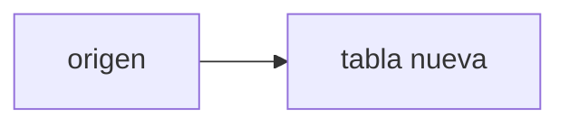

# Design: CHG-AAAA-NNN · <título>

- **Autor:** data-architect
- **Request:** `request.md` (aprobado AAAA-MM-DD)

## Resumen

Qué se construye y por qué así (3 a 5 líneas).

## Modelo

| Tabla | Capa | Tipo SDP | Grano | Claves | Historia | Nueva / cambia |
|---|---|---|---|---|---|---|
| `retail.<tabla>` | gold | materialized view | un … | `<x>_sk` (xxhash64) | SCD1 / SCD2 | nueva |

### Columnas

| Tabla | Columna | Tipo | Nulo | Regla / origen |
|---|---|---|---|---|

### Matriz de bus (si cambia gold)

## Grafo del pipeline

- Lenguaje de cada dataset (SQL para conjuntos, Python para helpers) y archivo donde vive.
- Dependencias: un dataset Python que lee una tabla del pipeline lo hace por una vista `src_*` (`docs/data-model.md`).

## Impacto

| Afectado | Cómo | Acción |
|---|---|---|
| `retail.<tabla existente>` | | |
| Controles de calidad | | |
| Reporte `RetailLakehouse` | | `/build-report` (G4) o ninguna |
| Documentación | | |

## Compatibilidad

¿Algún consumidor deja de funcionar (columna renombrada o borrada, cambio de grano)? Si sí, es un cambio
incompatible: plan de migración.

## Decisiones

| Decisión | Alternativas | Motivo |
|---|---|---|

## Riesgos y límites conocidos

Parquet (dos flows no escriben al mismo target), AUTO CDC sin Iceberg, costo de full refresh, etc.
