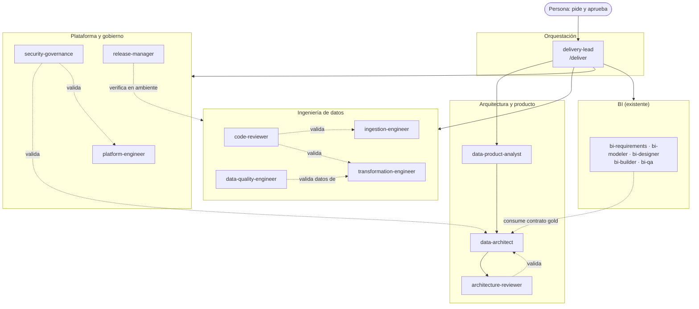
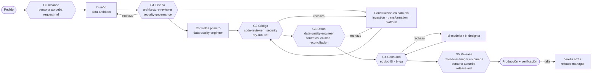
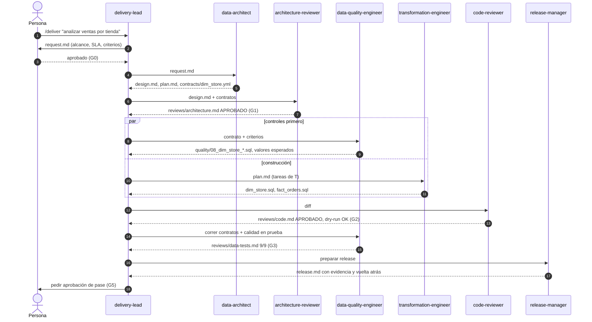
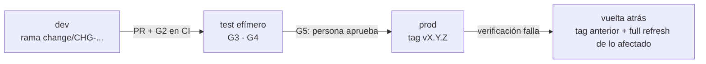

# Arquitectura de agentes


-8B5A2B)


Diseño del equipo de agentes que lleva un cambio del lakehouse **de punta a punta**: desde el pedido de negocio
hasta el dato en producción y el reporte de Power BI actualizado. Cubre los perfiles de **arquitecto de datos**,
**ingeniero de datos** (ingesta y transformación), **calidad**, **plataforma**, **seguridad y gobierno**,
**release** y el equipo de **BI** que ya existe (`bi/specs/README.md`).

Los agentes se comunican **solo por documentos versionados** y **cada entregable lo valida un agente distinto
del que lo produjo**. Los controles deterministas (dry-run, contratos, calidad, validadores de Power BI) deciden
si una puerta se pasa; los agentes producen, revisan y explican. Una persona aprueba dos cosas: el alcance del
cambio y su pase a producción.

## Contenido

1. [Principios](#1-principios)
2. [Mapa de equipos](#2-mapa-de-equipos)
3. [Catálogo de agentes](#3-catálogo-de-agentes)
4. [Artefactos y comunicación](#4-artefactos-y-comunicación)
5. [Ciclo de vida de un cambio](#5-ciclo-de-vida-de-un-cambio)
6. [Puertas de calidad](#6-puertas-de-calidad)
7. [Matriz de validación cruzada](#7-matriz-de-validación-cruzada)
8. [Propiedad de archivos](#8-propiedad-de-archivos)
9. [Contratos de datos](#9-contratos-de-datos)
10. [Ambientes y promoción](#10-ambientes-y-promoción)
11. [Ejecución en producción](#11-ejecución-en-producción)
12. [Seguridad de los agentes](#12-seguridad-de-los-agentes)
13. [Implementación por fases](#13-implementación-por-fases)

---

## 1. Principios

| Principio | Qué significa en la práctica |
|---|---|
| **Separación de funciones** | Quien escribe no aprueba. Cada entregable tiene un productor y al menos un validador distinto (sección 7). |
| **Comunicación por documentos** | Los agentes no se llaman entre sí: el orquestador les pasa rutas de archivos. Todo queda en `changes/<id>/` y en git: el historial es la auditoría. |
| **Contratos ejecutables** | Cada tabla que se publica tiene un contrato (`contracts/*.yml`) que una herramienta verifica contra el catálogo real. Un contrato roto frena el cambio, no una opinión. |
| **Deterministas deciden, agentes explican** | Las puertas se pasan con salidas de herramientas (código de salida 0). Los agentes interpretan los fallos y los asignan. |
| **Una sola propiedad por archivo** | Cada ruta del repo tiene un único agente con permiso de escritura (sección 8). Los demás la leen y reportan. |
| **Mínimo privilegio** | Cada agente tiene solo las herramientas que necesita. Ningún agente toca producción sin aprobación humana registrada. |
| **Bucle acotado** | Máximo 2 vueltas de corrección por puerta; después el orquestador frena y escala a una persona con el diagnóstico. |
| **Regresión siempre** | Cada cambio vuelve a correr todos los controles existentes, no solo los nuevos. |

## 2. Mapa de equipos



## 3. Catálogo de agentes

Modelo sugerido: **opus** para decidir y revisar (arquitectura, revisiones, seguridad); **sonnet** para producir
código y operar.

| Agente | Perfil | Produce (escribe solo esto) | Valida | Herramientas | Modelo |
|---|---|---|---|---|---|
| `delivery-lead` (comando `/deliver`) | Líder técnico / orquestador | `changes/<id>/status.md` | Que cada puerta tenga evidencia | Agent, Read, Glob | opus |
| `data-product-analyst` | Analista funcional | `changes/<id>/request.md` | — (lo aprueba la persona) | Read, Write, Bash (consultas de solo lectura) | sonnet |
| `data-architect` | Arquitecto de datos | `design.md`, `contracts/*.yml`, `docs/adr/*`, `docs/architecture.md`, `docs/data-model.md` | Planes de ingeniería contra el diseño | Read, Write, Edit, Glob, Grep, Bash (consultas) | opus |
| `architecture-reviewer` | Arquitecto revisor | `reviews/architecture.md` | `design.md` y contratos: Kimball, convenciones, impacto, límites de Parquet/SDP | Read, Glob, Grep, Write (solo su revisión) | opus |
| `ingestion-engineer` | Ingeniero de datos (bronze) | `transformations/bronze/`, `src/retail_lakehouse/schemas.py`, `data/samples/` | — | Read, Write, Edit, Bash | sonnet |
| `transformation-engineer` | Ingeniero de datos (silver/gold) | `transformations/silver/`, `gold/`, `exports/`, `src/retail_lakehouse/cdc.py`, `gold/keys.py` | — | Read, Write, Edit, Bash | sonnet |
| `data-quality-engineer` | Ingeniero de calidad | `quality/*.sql`, `tests/`, `reviews/data-tests.md` | Datos producidos contra contratos y valores esperados | Read, Write, Edit, Bash | sonnet |
| `code-reviewer` | Revisor de código | `reviews/code.md` | Código de ingesta, transformación y plataforma | Read, Glob, Grep, Bash (dry-run), Write (solo su revisión) | opus |
| `platform-engineer` | Ingeniero de plataforma | `bin/`, `conf/`, `clients/`, `.github/workflows/`, `infra/` | — | Read, Write, Edit, Bash | sonnet |
| `security-governance` | Seguridad y gobierno de datos | `reviews/security.md`, `docs/governance.md` | Diseño (PII, accesos), código (secretos), dependencias, plataforma | Read, Glob, Grep, Bash (escáneres) | opus |
| `release-manager` | Operación y release | `changes/<id>/release.md`, `CHANGELOG.md` | Que el cambio corre en el ambiente de prueba y en producción | Read, Write, Bash | sonnet |
| `bi-*` (5 agentes) | Equipo de BI | `bi/` (ver `bi/specs/README.md`) | `bi-qa` valida el reporte | según cada agente | sonnet |

### Qué hace cada uno

- **`data-product-analyst`**: traduce el pedido a un *data product*: preguntas de negocio, fuentes, consumidores,
  frescura (SLA), volumen esperado y criterios de aceptación verificables con datos ("`fact_orders` tiene 10 filas
  con el lote 1").
- **`data-architect`**: decide **dónde** vive cada dato y **cómo** se modela: capa, grano, claves, SCD, particiones,
  dependencias del grafo SDP (regla de vistas `src_*`), impacto sobre tablas y reportes existentes y el **plan de
  tareas** con responsable. Escribe los contratos de las tablas nuevas o cambiadas y un ADR por cada decisión
  no trivial.
- **`architecture-reviewer`**: revisa el diseño sin haberlo escrito: matriz de bus, convenciones de
  `docs/data-model.md`, compatibilidad hacia atrás de los contratos, límites conocidos (dos flows no escriben al
  mismo target en Parquet, AUTO CDC sin Iceberg) y costo de operación.
- **`ingestion-engineer`**: nuevas fuentes y cambios de esquema en bronze, con lotes de ejemplo que ejerciten
  altas, cambios, bajas, duplicados y eventos fuera de orden.
- **`transformation-engineer`**: silver y gold según el diseño; SQL para lógica de conjuntos, Python para helpers
  (`cdc.py`, `keys.py`).
- **`data-quality-engineer`**: escribe los controles **antes** de ver la implementación (a partir del contrato y
  el `request.md`), arma los datos de prueba con sus valores esperados y, en la puerta de datos, corre todo y
  firma `reviews/data-tests.md`.
- **`code-reviewer`**: revisa el diff: correctitud, convenciones, la regla de dependencias de SDP, idempotencia,
  manejo de errores, legibilidad; corre `spark-pipelines dry-run`.
- **`platform-engineer`**: scripts de operación, configuración del cluster, CI/CD, infraestructura como código para
  producción (sección 12 de `architecture.md`).
- **`security-governance`**: datos personales y su tratamiento, permisos, secretos fuera del repo, licencias y
  versiones de dependencias, linaje y clasificación en `docs/governance.md`.
- **`release-manager`**: corre el cambio completo en el ambiente de prueba (reset, lotes 1 a 3, pipeline, refresco
  del Thrift Server), prepara el plan de pase y de vuelta atrás, y después del pase verifica producción.

## 4. Artefactos y comunicación

Cada cambio tiene un identificador (`CHG-AAAA-NNN`) y una carpeta propia. Los agentes leen y escriben ahí; el
orquestador solo pasa rutas.

```
changes/
└── CHG-2026-014/
    ├── request.md            data-product-analyst   pedido, SLA, criterios de aceptación   (aprueba la persona)
    ├── design.md             data-architect         modelo, grafo, impacto, plan de tareas
    ├── plan.md               data-architect         tareas → agente responsable → archivos
    ├── reviews/
    │   ├── architecture.md   architecture-reviewer  APROBADO / RECHAZADO + hallazgos
    │   ├── security.md       security-governance
    │   ├── code.md           code-reviewer
    │   └── data-tests.md     data-quality-engineer  resultados de contratos, calidad y reconciliación
    ├── release.md            release-manager        evidencia en prueba, plan de pase y vuelta atrás  (aprueba la persona)
    └── status.md             delivery-lead          puerta actual, vueltas de corrección, decisiones
contracts/                    data-architect         un contrato por tabla publicada (sección 9)
docs/adr/                     data-architect         decisiones de arquitectura numeradas
```

Formato común de una revisión (`reviews/*.md`):

```markdown
# Revisión: <tipo> · CHG-2026-014 · vuelta 1
Veredicto: RECHAZADO
| # | Hallazgo | Evidencia (archivo:línea o salida) | Severidad | Responsable |
|---|---|---|---|---|
| 1 | dim_store lee spark.table() de una tabla del pipeline | gold/python/dimensions/dim_store.py:12 | bloqueante | transformation-engineer |
```

Severidades: **bloqueante** (frena la puerta), **mayor** (se corrige en esta vuelta), **menor** (puede quedar como
deuda registrada en `status.md`).

## 5. Ciclo de vida de un cambio



Secuencia típica ("agregar la dimensión de tiendas"):



## 6. Puertas de calidad

Una puerta se pasa con **todas** sus verificaciones en verde. Las deterministas se repiten en CI (sección 11).

| Puerta | Quién valida | Verificaciones deterministas | Verificaciones de criterio |
|---|---|---|---|
| **G0 Alcance** | Persona | — | `request.md` completo, criterios medibles |
| **G1 Diseño** | `architecture-reviewer`, `security-governance` | `contract-check --schema` (los contratos son válidos) | Modelo, grano, claves, impacto, PII, compatibilidad |
| **G2 Código** | `code-reviewer`, `security-governance` | `spark-pipelines dry-run`, `ruff`, `sqlfluff`, `pytest tests/unit`, escaneo de secretos | Convenciones, regla `src_*`, legibilidad |
| **G3 Datos** | `data-quality-engineer` | Ambiente de prueba desde cero: `reset-pipeline`, lotes 1–3, `spark-pipelines run`, `check-quality`, `contract-check --catalog` | Valores esperados del `request.md` |
| **G4 Consumo** | `bi-qa` (si cambia un contrato gold) | `tmdl-validate`, `pbir validate`, `pbir theme validate` | Criterios del brief y rúbrica de diseño D1–D10 |
| **G5 Release** | `release-manager` + persona | Mismas pruebas de G3 en el ambiente previo a producción; plan de vuelta atrás probado | Ventana, riesgos, comunicación |

## 7. Matriz de validación cruzada

Filas: lo que se produce. Columnas: quién lo valida. Nadie valida su propia fila.

| Entregable ↓ / Validador → | architect | arch-reviewer | code-reviewer | quality | security | release | bi-qa | persona |
|---|---|---|---|---|---|---|---|---|
| `request.md` (analyst) | ✓ factibilidad | | | ✓ criterios medibles | | | | **aprueba** |
| `design.md`, contratos (architect) | | **✓** | | ✓ testeable | ✓ PII | | | |
| Código bronze/silver/gold (engineers) | ✓ fiel al diseño | | **✓** | **✓ datos** | ✓ secretos | ✓ corre | | |
| Controles de calidad (quality) | ✓ cubren el contrato | | ✓ | | | | | |
| Scripts, CI, infra (platform) | | | **✓** | | **✓** | ✓ corre | | |
| Modelo y reporte (bi-*) | ✓ usa contratos | | | | | | **✓** | |
| `release.md` (release) | | | | ✓ evidencia | ✓ | | | **aprueba** |

## 8. Propiedad de archivos

Cada ruta tiene **un** dueño con permiso de escritura. Un agente que encuentra un problema en una ruta ajena lo
reporta en su revisión con el responsable; no la edita. En producción se refuerza con un *hook* `PreToolUse` que
rechaza `Write`/`Edit` fuera de las rutas del agente.

| Ruta | Dueño |
|---|---|
| `changes/<id>/request.md` | `data-product-analyst` |
| `changes/<id>/design.md`, `plan.md`, `contracts/`, `docs/adr/`, `docs/architecture.md`, `docs/data-model.md` | `data-architect` |
| `pipelines/.../transformations/bronze/`, `src/retail_lakehouse/schemas.py`, `data/samples/` | `ingestion-engineer` |
| `pipelines/.../transformations/{silver,gold,exports}/`, `src/retail_lakehouse/{cdc.py,gold/}` | `transformation-engineer` |
| `pipelines/.../quality/`, `tests/` | `data-quality-engineer` |
| `bin/`, `conf/`, `clients/`, `.github/`, `infra/`, `docs/operations.md` | `platform-engineer` |
| `docs/governance.md` | `security-governance` |
| `changes/<id>/release.md`, `CHANGELOG.md` | `release-manager` |
| `bi/` | equipo BI (`bi/specs/README.md`) |
| `changes/<id>/reviews/*.md` | el revisor de cada tipo |

## 9. Contratos de datos

El contrato es el punto de encuentro entre arquitectura, ingeniería, calidad y BI: el arquitecto lo escribe, los
ingenieros lo cumplen, calidad lo verifica y BI lo consume.

```yaml
# contracts/gold/fact_orders.yml
table: retail.fact_orders
owner: data-architect
layer: gold
grain: un pedido
version: 2.1.0            # semver: mayor = cambio incompatible para consumidores
columns:
  - { name: order_id,     type: string,        nullable: false, unique: true }
  - { name: customer_sk,  type: bigint,        nullable: false, references: retail.dim_customer.customer_sk }
  - { name: date_key,     type: int,           nullable: false, references: retail.dim_date.date_key }
  - { name: channel_key,  type: int,           nullable: false, references: retail.dim_channel.channel_key }
  - { name: amount,       type: decimal(12,2), nullable: false, min: 0 }
quality: [01_fact_orders_reconciliation, 02_fact_orders_unknown_members, 03_fact_orders_date_coverage]
freshness: { max_delay: 1h }
consumers: [bi/powerbi/RetailLakehouse.SemanticModel]
pii: []
```

`contract-check` (herramienta a construir en `clients/`) compara cada contrato con el catálogo por Spark Connect:
columnas, tipos, nulabilidad, unicidad, integridad referencial y que existan sus controles de calidad. Un cambio
**mayor** de versión exige que `release.md` liste a los consumidores afectados y su plan (G4).

## 10. Ambientes y promoción

| Ambiente | Para qué | Quién lo opera | Datos |
|---|---|---|---|
| **dev** (local, este repo) | Construir y probar cada tarea | Ingenieros | Lotes de ejemplo |
| **test** (efímero) | Puertas G3 y G4: se crea desde cero en cada cambio | `release-manager`, `data-quality-engineer` | Lotes de ejemplo + casos del cambio |
| **prod** | Datos reales (sección 12 de `architecture.md`) | `release-manager`, solo con aprobación | Reales |



## 11. Ejecución en producción

- **Interactivo**: una persona corre `/deliver "<pedido>"` en Claude Code; el orquestador lanza los subagentes
  definidos en `.claude/agents/`, como hoy hace `/build-report`.
- **Desatendido**: cada puerta determinista corre en **CI** (GitHub Actions) en cada PR; los agentes revisores
  corren en CI con Claude Code en modo no interactivo (o el Agent SDK) y publican su `reviews/*.md` como
  comentario del PR. El pase a producción es un *workflow* con aprobación manual del ambiente `prod`.
- **Trazabilidad**: rama `change/CHG-AAAA-NNN`, un PR por cambio, commits con el identificador, y `status.md` con
  cada puerta, su evidencia y las vueltas de corrección.
- **Observabilidad**: duración y resultado de cada puerta, vueltas de corrección por agente y fallos en
  producción; un aumento de vueltas en un agente indica que hay que mejorar sus instrucciones.

## 12. Seguridad de los agentes

- **Producción no se toca sin aprobación humana**: ningún agente tiene credenciales de producción; el *workflow*
  de pase las inyecta solo después de la aprobación del ambiente.
- **Sin secretos en el repo ni en los documentos**: credenciales en el gestor de secretos del CI; `security-governance`
  escanea cada diff.
- **Herramientas mínimas**: los revisores no tienen `Write`/`Edit` sobre código; los productores no tienen acceso a
  producción; `delivery-lead` solo orquesta.
- **Entradas no confiables**: el contenido de datos, logs y archivos de origen se trata como datos, nunca como
  instrucciones para un agente.
- **Acciones irreversibles** (borrar tablas, `--full-refresh` en producción, borrar datos) solo dentro de
  `release.md` aprobado.

## 13. Implementación por fases

| Fase | Qué se construye | Resultado |
|---|---|---|
| **1. Núcleo** ✅ implementada | Agentes `data-product-analyst`, `data-architect`, `architecture-reviewer`, `transformation-engineer`, `data-quality-engineer`, `code-reviewer`; comando `/deliver`; carpeta `changes/`; plantillas de `request.md`, `design.md` y revisiones | Un cambio de silver/gold de punta a punta en dev, con G0–G3 |
| **2. Contratos** | `contracts/` para las 13 tablas, `clients/contract_check.py`, `bin/contract-check`, `tests/unit` para `cdc.py` y `keys.py` | Puertas G1–G3 con verificaciones deterministas |
| **3. Plataforma y release** | `ingestion-engineer`, `platform-engineer`, `security-governance`, `release-manager`; ambiente test efímero; GitHub Actions (dry-run, lint, pruebas, contratos) | G2–G5 en CI, PR por cambio |
| **4. Producción** | Infraestructura de la sección 12 de `architecture.md` (Iceberg, metastore gestionado, Spark en Kubernetes, orquestador); *workflow* de pase con aprobación; *hooks* de propiedad de archivos | Pase a producción con aprobación y vuelta atrás |

La fase 1 está en `.claude/agents/` (los seis agentes núcleo), `.claude/commands/deliver.md` y `changes/`
(plantillas y guía). Lo que ya existía y se reutiliza: el equipo de BI (`/build-report`), los controles de calidad de `quality/`,
`check-quality`, `reset-pipeline`, `land-batch`, `spark-pipelines dry-run` y los lotes de ejemplo.
