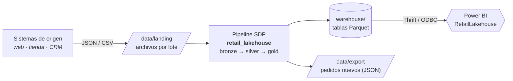
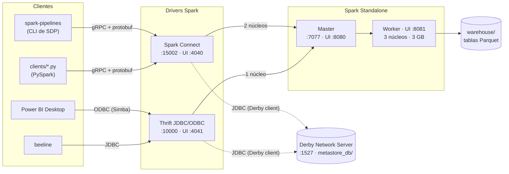
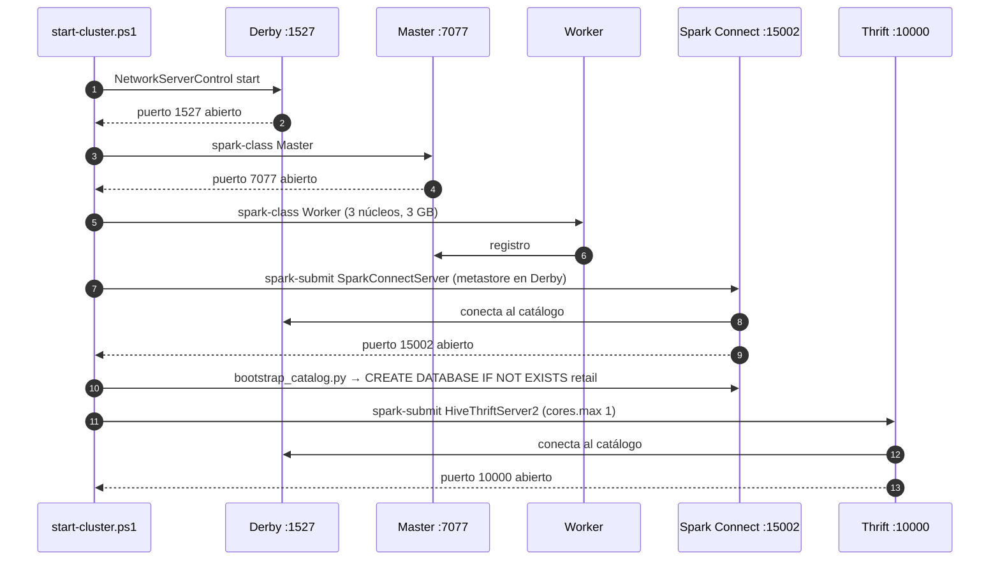
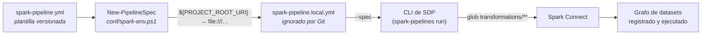
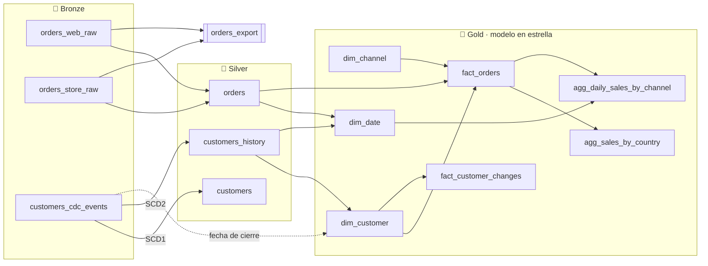
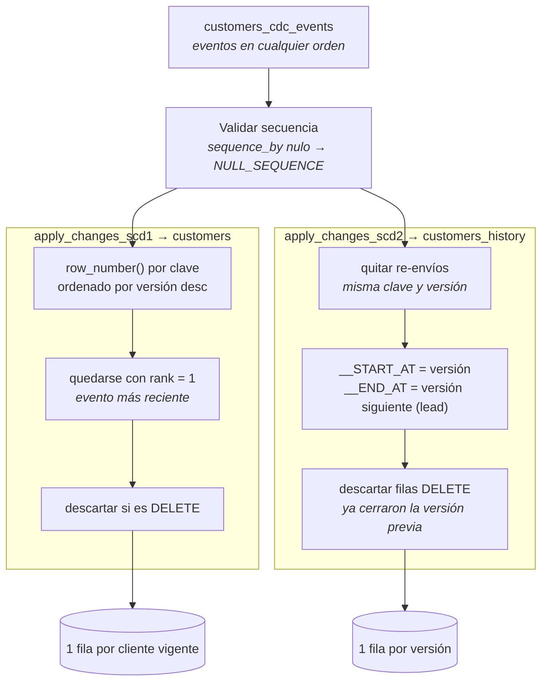
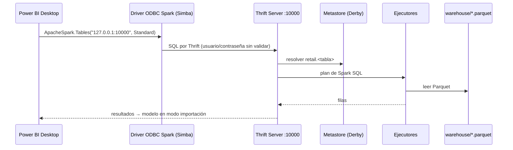
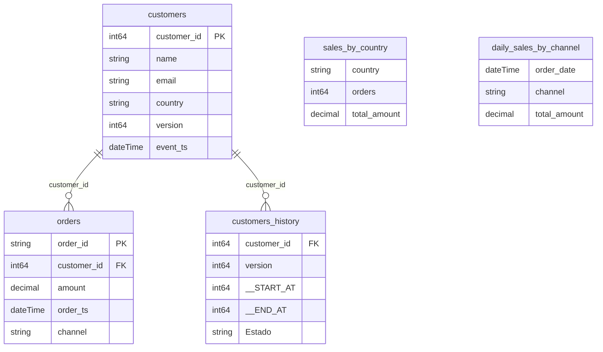
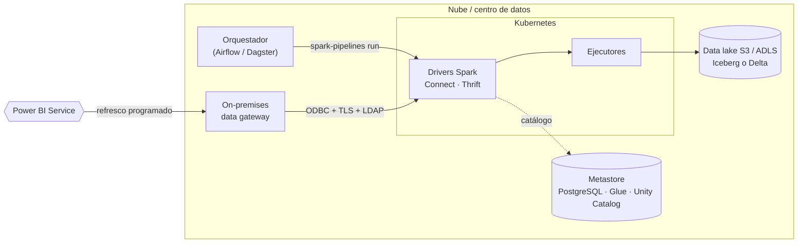

# Arquitectura


-8B5A2B)


Definición técnica del proyecto: qué procesos corren, cómo se comunican, cómo fluyen los datos de capa en capa,
cómo se aplica el CDC y cómo llega todo a Power BI. Para la operación diaria (scripts, logs, errores) ver
[`operations.md`](operations.md).

## Contenido

1. [Visión general](#1-visión-general)
2. [Componentes en ejecución](#2-componentes-en-ejecución)
3. [Arranque y apagado](#3-arranque-y-apagado)
4. [Pipeline declarativo](#4-pipeline-declarativo)
5. [Capa bronze: ingesta incremental](#5-capa-bronze-ingesta-incremental)
6. [Capa silver: unión y CDC](#6-capa-silver-unión-y-cdc)
7. [Capa gold y exportaciones](#7-capa-gold-y-exportaciones)
8. [Consumo: Thrift Server y Power BI](#8-consumo-thrift-server-y-power-bi)
9. [Almacenamiento y estado](#9-almacenamiento-y-estado)
10. [Seguridad](#10-seguridad)
11. [Decisiones de diseño](#11-decisiones-de-diseño)
12. [Camino a producción](#12-camino-a-producción)

---

## 1. Visión general

-8B5A2B)

Un **lakehouse de retail** que recibe pedidos de dos canales (web y tienda) y eventos de cambio de clientes,
los procesa en tres capas con Spark Declarative Pipelines y los publica para análisis en Power BI.



| Aspecto | Definición |
|---|---|
| Entradas | Pedidos web (JSON), pedidos de tienda (CSV), eventos CDC de clientes (JSON) |
| Procesamiento | Spark 4.3 Standalone, pipeline declarativo ejecutado por Spark Connect |
| Salidas | 13 tablas en el catálogo `retail` (gold: modelo en estrella + agregados), un sink de pedidos en JSON, reportes de Power BI |
| Modo | Por lotes incrementales: cada ejecución procesa solo los archivos nuevos |

## 2. Componentes en ejecución




| Proceso | Puerto | Clase principal | Rol |
|---|---|---|---|
| Derby Network Server | 1527 | `org.apache.derby.drda.NetworkServerControl` | Base del Hive metastore, en modo red para que la compartan dos JVM |
| Master | 7077 (UI 8080) | `org.apache.spark.deploy.master.Master` | Asigna recursos a las aplicaciones |
| Worker | UI 8081 | `org.apache.spark.deploy.worker.Worker` | Lanza los ejecutores (3 núcleos, 3 GB) |
| Spark Connect | 15002 (UI 4040) | `org.apache.spark.sql.connect.service.SparkConnectServer` | Recibe planes de DataFrame; ejecuta el pipeline |
| Thrift JDBC/ODBC | 10000 (UI 4041) | `org.apache.spark.sql.hive.thriftserver.HiveThriftServer2` | HiveServer2 sobre Spark SQL; recibe SQL de herramientas de BI |

**Dos drivers, un cluster, un catálogo.** Connect y Thrift son dos aplicaciones Spark independientes
(`spark.cores.max` 2 y 1) con la misma configuración: `conf/spark-defaults.conf`, el mismo
`spark.sql.warehouse.dir` y la misma URL del metastore. Cualquier tabla que escribe el pipeline es visible de
inmediato por SQL.

| | Spark Connect | Thrift JDBC/ODBC Server |
|---|---|---|
| Recibe | Planes de DataFrame (protobuf) | Texto SQL |
| Transporte | gRPC | Thrift (protocolo de HiveServer2) |
| Resultados | Lotes Apache Arrow | Filas por el protocolo de Hive |
| Clientes | CLI de pipelines, PySpark | Power BI, beeline, cualquier herramienta JDBC/ODBC |

## 3. Arranque y apagado


`bin/start-cluster` levanta los procesos en orden de dependencia y espera a que cada puerto responda antes de
seguir. Es idempotente: si un proceso ya corre, lo saltea.



`bin/stop-cluster` apaga en orden inverso: Thrift, Connect, worker, master, ejecutores huérfanos y, al final,
Derby con un apagado ordenado (`NetworkServerControl shutdown`), cuando ya no quedan clientes del catálogo.

## 4. Pipeline declarativo


El pipeline `retail_lakehouse` se define en `pipelines/retail_lakehouse/`: una spec y 10 archivos de
transformaciones (Python y SQL) que declaran datasets. SDP arma el grafo de dependencias y ejecuta cada
dataset en orden.

### Spec portable

`spark-pipeline.yml` es una **plantilla**: las rutas absolutas que SDP exige (`storage`, raíces de landing y
export) se escriben como `${PROJECT_ROOT_URI}`. `bin/spark-pipelines` las resuelve para la máquina actual.



### Grafo de datasets



| Capa | Dataset | Tipo SDP | Lenguaje | Lee de |
|---|---|---|---|---|
| bronze | `orders_web_raw` | streaming table | Python | `data/landing/orders_web/*.json` |
| bronze | `orders_store_raw` | streaming table | Python | `data/landing/orders_store/*.csv` |
| bronze | `customers_cdc_events` | streaming table | Python | `data/landing/customers_cdc/*.json` |
| silver | `orders` | materialized view | SQL | `orders_web_raw` ∪ `orders_store_raw` |
| silver | `customers` | materialized view | Python | `customers_cdc_events` (SCD1) |
| silver | `customers_history` | materialized view | Python | `customers_cdc_events` (SCD2) |
| gold · dimensión | `dim_channel` | materialized view | SQL | Lista fija de canales |
| gold · dimensión | `dim_date` | materialized view | SQL | Rango de fechas de `orders` y `customers_history` |
| gold · dimensión | `dim_customer` | materialized view | Python | `customers_history` (+ fecha de cierre de `customers_cdc_events`) |
| gold · hecho | `fact_orders` | materialized view | SQL | `orders` ⋈ `dim_customer` (versión vigente al comprar) ⋈ `dim_channel` |
| gold · hecho | `fact_customer_changes` | materialized view | Python | `dim_customer` (versión N-1 → N) |
| gold · agregado | `agg_sales_by_country` | materialized view | SQL | `fact_orders` + `dim_customer` |
| gold · agregado | `agg_daily_sales_by_channel` | materialized view | SQL | `fact_orders` + `dim_date` + `dim_channel` |
| exports | `orders_export` | sink + append flow | Python | `orders_web_raw` ∪ `orders_store_raw` (streaming) |

El código de gold está separado por lenguaje y por tipo de objeto: `gold/sql/{dimensions,facts,aggregates}` y
`gold/python/{dimensions,facts}`. El detalle del modelo está en [`data-model.md`](data-model.md).

## 5. Capa bronze: ingesta incremental


Cada fuente es un **streaming table** con esquema explícito (`src/retail_lakehouse/schemas.py`): Structured
Streaming no infiere esquemas en lecturas incrementales. El checkpoint de cada tabla vive en `storage/` y
registra qué archivos ya se procesaron, así que cada ejecución lee **solo los archivos nuevos**.

| Esquema | Columnas | Usado por |
|---|---|---|
| `ORDERS_SCHEMA` | `order_id` string · `customer_id` int · `amount` decimal(12,2) · `order_ts` timestamp | `orders_web_raw`, `orders_store_raw` |
| `CUSTOMERS_CDC_SCHEMA` | `customer_id` int · `name` · `email` · `country` · `op` (INSERT/UPDATE/DELETE) · `version` long · `event_ts` timestamp | `customers_cdc_events` |

Columnas agregadas en la ingesta:

| Columna | Tablas | Contenido |
|---|---|---|
| `channel` | pedidos | `web` o `store`, según la fuente |
| `_ingested_at` | todas | Momento de ingesta; desempata duplicados en silver |
| `_source_file` | `customers_cdc_events` | Archivo de origen (`_metadata.file_name`), para trazabilidad |

## 6. Capa silver: unión y CDC


### Pedidos

`silver.orders` une los dos canales y elimina duplicados por `order_id`, quedándose con la primera ingesta
(`row_number() OVER (PARTITION BY order_id ORDER BY _ingested_at)`).

### Clientes: Change Data Capture

Los eventos de `customers_cdc_events` se aplican con `src/retail_lakehouse/cdc.py`, que reproduce la semántica
de `dp.create_auto_cdc_flow` (AUTO CDC) con los mismos parámetros:

```python
keys=["customer_id"], sequence_by="version", apply_as_deletes="op = 'DELETE'",
except_column_list=["op", "_ingested_at", "_source_file"]
```



| Regla | Comportamiento |
|---|---|
| Inserts y updates | Por clave gana el evento con el `version` más alto |
| Deletes | SCD1: la clave desaparece · SCD2: la última versión se cierra sin crear una nueva |
| Eventos desordenados o repetidos | Convergen al mismo resultado |
| `version` nulo | Error `NULL_SEQUENCE`, igual que AUTO CDC |
| Empate de `version` en una clave | Se resuelve de forma arbitraria |

**Ejemplo real (cliente 3).** Los eventos llegan desordenados: la versión 2 aterriza en el lote 3, después
de la versión 3.

| Lote | Evento | Versión | País |
|---|---|---|---|
| 1 | INSERT | 1 | Uruguay |
| 2 | UPDATE | 3 | Brasil |
| 3 | UPDATE *(llega tarde)* | 2 | Paraguay |

Resultado:

| Tabla | Filas del cliente 3 |
|---|---|
| `customers` (SCD1) | Brasil, versión 3 (la versión 2 tardía no la pisa) |
| `customers_history` (SCD2) | Uruguay `[1, 2)` · Paraguay `[2, 3)` · Brasil `[3, vigente)` |

## 7. Capa gold y exportaciones

-8B5A2B)

La capa gold es un **modelo dimensional (esquema en estrella)**: dimensiones, hechos y agregados derivados de
los hechos. El detalle completo (diagrama, matriz de bus, granos, convenciones y controles de calidad) está en
[`data-model.md`](data-model.md).

| Tipo | Dataset | Grano |
|---|---|---|
| Dimensión | `dim_customer` | Una versión de un cliente (SCD2 con vigencia por fecha) |
| Dimensión | `dim_date` | Un día |
| Dimensión | `dim_channel` | Un canal |
| Hecho | `fact_orders` | Un pedido, unido a la versión del cliente vigente al comprar |
| Hecho | `fact_customer_changes` | Un cambio de versión de un cliente |
| Agregado | `agg_sales_by_country` | Un país (actual) del cliente |
| Agregado | `agg_daily_sales_by_channel` | Un día × un canal |

Claves sustitutas determinísticas (`xxhash64`), miembro desconocido `-1` en cada dimensión y 7 controles de
calidad que se corren con `bin/check-quality`.

**Exportaciones.** `orders_export` es un **sink** de Structured Streaming (en producción sería Kafka o Event Hubs;
aquí, archivos JSON en `data/export/orders`). Un único append flow une los dos canales y cada ejecución exporta
solo los pedidos nuevos.

## 8. Consumo: Thrift Server y Power BI


El reporte `bi/powerbi/RetailLakehouse.pbip` es un proyecto PBIP con modelo **TMDL** (generado por
`bi/powerbi/tools/generate_model.py`) y reporte **PBIR** (creado con el CLI `pbir`).



### Modelo semántico



| Tabla | Medidas |
|---|---|
| `orders` | Ventas totales · Pedidos · Clientes con compras · Ticket promedio |
| `customers` | Clientes actuales |
| `customers_history` | Versiones · Cambios registrados (+ columna calculada `Estado`: Vigente / Histórica) |
| `sales_by_country` | Ventas por país |
| `daily_sales_by_channel` | Ventas diarias |

Las tablas gold del reporte (`sales_by_country`, `daily_sales_by_channel`) leen de los agregados
`agg_sales_by_country` y `agg_daily_sales_by_channel` (campo `source` de `model.json`) y no se relacionan con el
resto: ya están agregadas. Los reportes nuevos pueden usar directamente la estrella (`fact_*` + `dim_*`). El servidor (`SparkServer`) es un parámetro
de Power Query, así que apuntar el reporte a otro Thrift Server no requiere tocar las tablas.

## 9. Almacenamiento y estado


| Carpeta | Contenido | En Git | Se regenera con |
|---|---|---|---|
| `warehouse/retail.db/` | Archivos Parquet de cada tabla | No | `spark-pipelines run` |
| `metastore_db/` | Catálogo Hive (Derby): tablas, esquemas, ubicaciones | No | `start-cluster` (vacío) + pipeline |
| `storage/` | Checkpoints de los streaming tables | No | `spark-pipelines run` |
| `data/landing/` | Archivos aterrizados | No | `land-batch` |
| `data/export/` | Salida del sink | No | `spark-pipelines run` |
| `logs/`, `work/` | Logs de procesos y directorios de trabajo de Spark | No | Cada arranque |
| `tools/derby/` | Jars de Derby (red y cliente) | No | `setup-dependencies` |

El catálogo guarda la **ruta absoluta** de cada tabla: mover `warehouse/` rompe las tablas. Para empezar de cero,
`bin/reset-pipeline` borra todo el estado y reinicia el cluster.

## 10. Seguridad


Configuración de **desarrollo local**:

- Todos los servicios escuchan solo en `127.0.0.1`: no son accesibles desde la red.
- El Thrift Server usa autenticación `NONE`: el cliente debe enviar usuario y contraseña, pero no se validan.
- Derby y Spark Connect no tienen autenticación.
- Los jars de terceros se descargan de Maven Central y se verifica su SHA-1 (`bin/setup-dependencies`).
- El repositorio no contiene credenciales ni rutas de una máquina en particular (spec en plantilla).

## 11. Decisiones de diseño

| Decisión | Motivo | Consecuencia |
|---|---|---|
| Tablas **Parquet** | Iceberg no tiene runtime para Spark 4.3 | Dos flows no pueden escribir al mismo target: un streaming table por canal y unión en silver |
| CDC en **materialized views** (`cdc.py`) | AUTO CDC necesita un catálogo con operaciones a nivel fila | Mismos parámetros que AUTO CDC: migrar es cambiar una llamada |
| **Derby en modo red** | Derby embebido admite una sola JVM | Connect y Thrift comparten el catálogo |
| **Spec como plantilla** | SDP exige rutas absolutas | El repo funciona en cualquier máquina |
| **Thrift Server** para BI | Power BI no habla Spark Connect | Power BI usa su conector nativo de Spark por ODBC |
| Modelo **TMDL generado** | Tipos y medidas reproducibles desde código | `lineageTag` determinísticos: regenerar no cambia la identidad de los objetos |

## 12. Camino a producción




| Hoy (local) | Producción |
|---|---|
| Disco local | Almacenamiento de objetos (S3, ADLS, GCS) |
| Parquet | Apache Iceberg o Delta Lake (transacciones, `MERGE`, AUTO CDC) |
| Derby | Metastore en PostgreSQL/MySQL gestionado, Unity Catalog o AWS Glue |
| Standalone en una máquina | Kubernetes (Spark on K8s) o YARN |
| Thrift sin autenticación en `127.0.0.1` | Thrift con LDAP/Kerberos y TLS, en red privada |
| Ejecución manual | Orquestador (Airflow, Dagster) |
| Power BI Desktop | Power BI Service + On-premises data gateway |

Alternativa habitual: una plataforma gestionada (Databricks, Microsoft Fabric, Synapse, EMR) que ya resuelve
cómputo, catálogo, almacenamiento y endpoint SQL. Las transformaciones del pipeline se trasladan sin cambios de
lógica.
