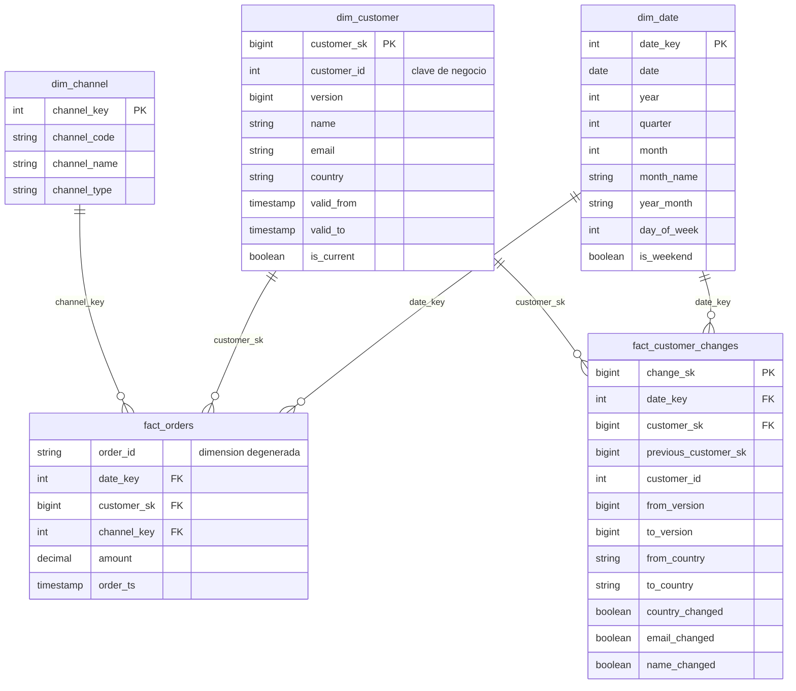

# Modelo dimensional (capa gold)

-8B5A2B)


La capa gold es un **modelo en estrella** (Kimball): tablas de hechos con métricas y claves, rodeadas de
dimensiones con atributos descriptivos. Los agregados se calculan desde los hechos, así que todos los
reportes parten de la misma fuente de verdad.

## Contenido

1. [Organización del código](#1-organización-del-código)
2. [Esquema en estrella](#2-esquema-en-estrella)
3. [Matriz de bus](#3-matriz-de-bus)
4. [Dimensiones](#4-dimensiones)
5. [Hechos](#5-hechos)
6. [Agregados](#6-agregados)
7. [Convenciones](#7-convenciones)
8. [Controles de calidad](#8-controles-de-calidad)

---

## 1. Organización del código

```
pipelines/retail_lakehouse/transformations/gold/
├── sql/                              lógica de conjuntos (joins, agregaciones, listas fijas)
│   ├── inputs.sql                    vistas src_* que leen los datasets Python (ver "Dependencias")
│   ├── dimensions/
│   │   ├── dim_channel.sql
│   │   └── dim_date.sql
│   ├── facts/
│   │   └── fact_orders.sql
│   └── aggregates/
│       ├── agg_sales_by_country.sql
│       └── agg_daily_sales_by_channel.sql
└── python/                           lógica que reutiliza helpers (claves, SCD2, ventanas)
    ├── dimensions/
    │   └── dim_customer.py
    └── facts/
        └── fact_customer_changes.py

src/retail_lakehouse/gold/keys.py     claves sustitutas, claves de fecha, miembro desconocido
pipelines/retail_lakehouse/quality/   un control de calidad por archivo .sql
```

**Dependencias (regla importante).** Un dataset **Python** que lee una tabla del pipeline que **ya existe en el
catálogo** (`spark.table("customers_history")`) la resuelve como tabla externa: SDP no registra la dependencia,
lo ejecuta en paralelo con su origen y lee la tabla mientras se reescribe (vacía o de la corrida anterior). Solo
funciona bien en la primera corrida, con el catálogo vacío. En **SQL** (`FROM customers_history`) la dependencia
se registra siempre.

Por eso los datasets Python leen las tablas del pipeline a través de **vistas temporales SQL `src_*`**
(`silver/inputs.sql`, `gold/sql/inputs.sql`): una vista temporal no existe en el catálogo, SDP la resuelve dentro
del grafo y el dataset espera a su origen. Los controles de calidad 02 y 07 detectan el síntoma si se rompe.

| Vista | Origen | La leen |
|---|---|---|
| `src_customers_cdc_events` | `bronze.customers_cdc_events` | `customers`, `customers_history`, `dim_customer` |
| `src_customers_history` | `silver.customers_history` | `dim_customer` |
| `src_dim_customer` | `gold.dim_customer` | `fact_customer_changes` |

**Criterio:** SQL para lo que se expresa como una consulta; Python cuando la lógica usa los helpers
compartidos de `src/retail_lakehouse/gold/`. El tipo de objeto (dimensión, hecho, agregado) decide la
subcarpeta, en los dos lenguajes. SDP encuentra todos los archivos por el glob `transformations/**`.

## 2. Esquema en estrella



## 3. Matriz de bus

Qué dimensiones comparte cada hecho. Una dimensión **conformada** (usada por más de un hecho) permite
cruzar procesos de negocio con los mismos filtros.

| Hecho \ Dimensión | `dim_date` | `dim_customer` | `dim_channel` |
|---|:---:|:---:|:---:|
| `fact_orders` | ✓ | ✓ | ✓ |
| `fact_customer_changes` | ✓ | ✓ | |

## 4. Dimensiones

| Dimensión | Grano | Origen | Lenguaje | Notas |
|---|---|---|---|---|
| `dim_customer` | Una versión de un cliente | `silver.customers_history` + `bronze.customers_cdc_events` | Python | SCD tipo 2 con vigencia por fecha |
| `dim_date` | Un día | Rango de `silver.orders` y `silver.customers_history` | SQL | Años completos; nombres en español; semana ISO |
| `dim_channel` | Un canal | Lista fija | SQL | `channel_code` = valor de `orders.channel` |

### `dim_customer`: vigencia por fecha

El SCD2 de silver expresa la vigencia en **números de versión** (`__START_AT`, `__END_AT`). Los hechos
necesitan **fechas** para unirse a la versión vigente en el momento de cada pedido:

- `valid_from` = `event_ts` del evento que creó la versión.
- `valid_to` = `event_ts` del evento que la cerró: la versión siguiente o un `DELETE`. Como silver no guarda
  las filas de `DELETE`, la fecha se toma de `bronze.customers_cdc_events`. Vigente: `9999-12-31 23:59:59`.
- `is_current` = la versión no fue reemplazada ni borrada. Un cliente dado de baja no tiene versión vigente.

Ejemplo (cliente 4, Diego Ruiz: alta, baja y nueva alta):

| version | country | valid_from | valid_to | is_current |
|---|---|---|---|---|
| 1 | Argentina | 2026-11-01 09:15 | 2026-11-02 08:30 *(DELETE)* | false |
| 3 | Mexico | 2026-11-03 09:00 | 9999-12-31 23:59:59 | true |

## 5. Hechos

| Hecho | Grano | Métricas | Dimensiones |
|---|---|---|---|
| `fact_orders` | Un pedido | `amount` | fecha, cliente (versión vigente al comprar), canal |
| `fact_customer_changes` | Un cambio de versión de un cliente | indicadores `country_changed`, `email_changed`, `name_changed` | fecha del cambio, cliente (versión nueva) |

### Unión con la versión vigente al momento del pedido

`fact_orders` une cada pedido a la versión del cliente cuya vigencia contiene `order_ts`:

```sql
LEFT JOIN dim_customer c
  ON  c.customer_id = o.customer_id
  AND o.order_ts >= c.valid_from
  AND o.order_ts <  c.valid_to
```

Así una venta queda asociada al país donde estaba el cliente **cuando compró**. Con los datos de ejemplo:

| Pedido | Cliente | País al comprar | País actual |
|---|---|---|---|
| W-1002 | Bruno Diaz | Chile | Argentina |
| S-2001 | Carla Perez | Uruguay | Brasil |
| W-1003 | Diego Ruiz | Argentina | Mexico |

Si un pedido no cae en ninguna vigencia (cliente que todavía no llegó por CDC, o compra durante el lapso de
una baja) se asigna al miembro desconocido `-1` y el control de calidad 02 lo reporta.

## 6. Agregados

Se calculan **desde `fact_orders`**, nunca directamente desde silver.

| Agregado | Grano | Semántica |
|---|---|---|
| `agg_sales_by_country` | Un país | Ventas por país **actual** del cliente (para país al comprar, usar `fact_orders` + `dim_customer`) |
| `agg_daily_sales_by_channel` | Un día × un canal | Pedidos e importe por día y canal |

## 7. Convenciones

| Elemento | Convención | Ejemplo |
|---|---|---|
| Dimensiones / hechos / agregados | `dim_*` / `fact_*` / `agg_*` | `dim_customer`, `fact_orders` |
| Clave sustituta | `*_sk`, `bigint`, `xxhash64` de la clave de negocio (+ versión) | `customer_sk` |
| Clave de fecha | `date_key`, `int` `yyyyMMdd` | `20261101` |
| Clave de dimensión fija | `*_key`, `int` | `channel_key` |
| Miembro desconocido | Clave `-1` en cada dimensión | `customer_sk = -1` |
| Vigencia SCD2 | `[valid_from, valid_to)`; vigente hasta `9999-12-31 23:59:59` | |
| Auditoría | `_loaded_at` (momento de carga) en todas las tablas gold | |

Las claves sustitutas son **hashes determinísticos** y no numeradores: los materialized views se recalculan
completos en cada ejecución y un numerador cambiaría de valor, rompiendo las relaciones.

## 8. Controles de calidad

`bin\check-quality.cmd` corre cada archivo de `pipelines/retail_lakehouse/quality/`: una consulta que
devuelve las filas que violan una regla (sin filas = pasa). Sale con código 1 si alguno falla.

| Control | Regla |
|---|---|
| `01_fact_orders_reconciliation` | `fact_orders` tiene los mismos pedidos e importe total que `silver.orders` |
| `02_fact_orders_unknown_members` | Ningún pedido quedó en el miembro desconocido |
| `03_fact_orders_date_coverage` | Cada `date_key` de los hechos existe en `dim_date` |
| `04_dim_customer_unique_sk` | `customer_sk` es único |
| `05_dim_customer_single_current` | Cada cliente tiene a lo sumo una versión vigente |
| `06_dim_customer_no_overlap` | Las vigencias de un cliente no se superponen |
| `07_fact_customer_changes_reconciliation` | Un cambio por cada versión posterior a la primera |

Para agregar un control: un archivo `NN_<tabla>_<regla>.sql` con la línea `-- check: <descripción>` y una
consulta que devuelva las filas en falta.
