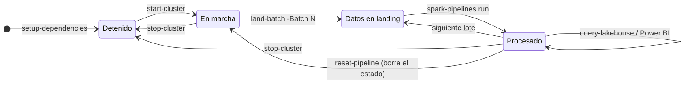

# Operación


Cómo instalar, levantar, operar y diagnosticar el proyecto. La definición técnica está en
[`architecture.md`](architecture.md).

## Contenido

1. [Ciclo de operación](#1-ciclo-de-operación)
2. [Instalación](#2-instalación)
3. [Scripts](#3-scripts)
4. [Logs e interfaces web](#4-logs-e-interfaces-web)
5. [Consultas SQL por el Thrift Server](#5-consultas-sql-por-el-thrift-server)
6. [Power BI](#6-power-bi)
7. [Solución de problemas](#7-solución-de-problemas)

---

## 1. Ciclo de operación



Todos los scripts están en `bin/`. Cada `.cmd` llama al `.ps1` del mismo nombre y los dos cargan el entorno desde
`conf/spark-env.ps1` (`SPARK_HOME`, `HADOOP_HOME`, `.venv`, rutas del proyecto).

## 2. Instalación


Requisitos: Java 17 (`JAVA_HOME`), Apache Spark 4.3.0 (`SPARK_HOME` como variable de usuario), `HADOOP_HOME` con
`winutils.exe` y Python 3.13.

```powershell
# Entorno Python (PySpark se usa desde SPARK_HOME\python, no se instala con pip)
python -m venv .venv
.venv\Scripts\python -m pip install -r requirements.txt

# Jars de Derby en modo red, con verificación SHA-1
bin\setup-dependencies.cmd
```

## 3. Scripts

| Script | Qué hace |
|---|---|
| `setup-dependencies` | Descarga los jars de Derby (servidor de red y cliente) a `tools/derby/` y verifica su SHA-1. Idempotente. |
| `start-cluster [-WorkerCores 3] [-WorkerMemory 3g] [-NoThrift]` | Levanta Derby, master, worker y Spark Connect, crea la base `retail` y levanta el Thrift Server. Idempotente. |
| `stop-cluster` | Detiene Thrift, Connect, worker, master y por último Derby (apagado ordenado). |
| `land-batch -Batch N [-Reset]` | Copia `data/samples/batch-00N` a `data/landing/`. `-Reset` vacía landing y export. |
| `spark-pipelines run` / `dry-run` | CLI de SDP contra Spark Connect. Renderiza la spec y acepta las opciones de `spark-pipelines` (`--refresh`, `--full-refresh`, …). |
| `query-lakehouse [tablas...]` | Muestra las tablas del pipeline por Spark Connect. |
| `reset-pipeline` | Borra todo el estado (tablas, checkpoints, metastore, landing, export) y reinicia el cluster. |

Ejemplo de una corrida completa con los tres lotes de ejemplo, desde un estado limpio
(`reset-pipeline` borra el estado y deja el cluster levantado):

```powershell
bin\reset-pipeline.cmd
bin\land-batch.cmd -Batch 1
bin\spark-pipelines.cmd run
bin\land-batch.cmd -Batch 2
bin\spark-pipelines.cmd run
bin\land-batch.cmd -Batch 3
bin\spark-pipelines.cmd run
bin\query-lakehouse.cmd customers customers_history
```

## 4. Logs e interfaces web

| Proceso | Log | Interfaz web |
|---|---|---|
| Derby | `logs/derby.log` | — |
| Master | `logs/master.log` | http://127.0.0.1:8080 |
| Worker | `logs/worker.log` | http://127.0.0.1:8081 |
| Spark Connect | `logs/connect-server.log` | http://127.0.0.1:4040 (pestaña *Connect*: sesiones y planes) |
| Thrift Server | `logs/thrift-server.log` | http://127.0.0.1:4041 (pestaña *JDBC/ODBC Server*) |

El nivel de log se define en `conf/log4j2.properties` (`warn` por defecto).

## 5. Consultas SQL por el Thrift Server


```powershell
& "$env:SPARK_HOME\bin\beeline.cmd" -u jdbc:hive2://127.0.0.1:10000 -n powerbi -p powerbi
```

```sql
SHOW TABLES IN retail;
SELECT * FROM retail.sales_by_country ORDER BY total_amount DESC;
```

Usuario y contraseña son obligatorios para el cliente, pero el servidor no los valida (autenticación `NONE`).

## 6. Power BI


1. Con el cluster levantado, abrir `bi/powerbi/RetailLakehouse.pbip` con Power BI Desktop **2.159 o posterior**
   y la versión preliminar *Store reports using enhanced metadata format (PBIR)* activada.
2. **Actualizar**. En credenciales elegir *Nombre de usuario y contraseña* (cualquier valor) y, si lo pide,
   aceptar la conexión sin cifrar.

### Regenerar el modelo semántico

El TMDL se genera desde `bi/powerbi/tools/generate_model.py` (tablas, tipos, medidas, relaciones). Los
`lineageTag` son determinísticos, así que regenerar no cambia la identidad de los objetos:

```powershell
.venv\Scripts\python bi\powerbi\tools\generate_model.py
```

Los visuales se crearon con el CLI `pbir` a partir de `bi/powerbi/tools/visuals-*.json`. Con la opción
*Enable external tool access…* activada en Desktop, `pbir desktop refresh` recarga el reporte abierto y
`pbir desktop screenshot` captura sus páginas (así se generaron las imágenes de `docs/images/`).

## 7. Solución de problemas

| Síntoma | Causa | Solución |
|---|---|---|
| *Report is using the PBIR format. Please enable the preview feature…* | Formato PBIR desactivado en Desktop | Opciones → Características en versión preliminar → *Store reports using enhanced metadata format (PBIR)*; reiniciar Desktop |
| *Can't resolve schema '3.3.0' in 'report.json'* | Power BI Desktop anterior a 2026 | Actualizar Desktop. Si conviven la versión de Microsoft Store y la instalada (MSI), abrir con `C:\Program Files\Microsoft Power BI Desktop\bin\PBIDesktop.exe` |
| beeline se queda esperando | Pide la contraseña por teclado | Pasar `-p` con cualquier valor |
| `Derby client not found in tools\derby` | Faltan los jars de Derby en modo red | `bin\setup-dependencies.cmd` |
| Un script falla con *NativeCommandError* | PowerShell 5.1 trata el stderr de un ejecutable como error si se redirige con `2>&1` | Usar los `.cmd` de `bin\`, o no redirigir stderr |
| `Spark Connect server is not running` | El cluster está detenido | `bin\start-cluster.cmd` |
| `FAILED_READ_FILE.FILE_NOT_EXIST` tras `--full-refresh-all` | Limitación de SDP con tablas Parquet | `bin\reset-pipeline.cmd` |
| *Filename too long* al clonar | Rutas largas en Windows (límite de 260 caracteres) | `git config --global core.longpaths true` y clonar en una ruta corta |
